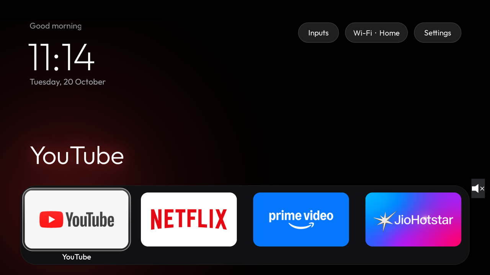
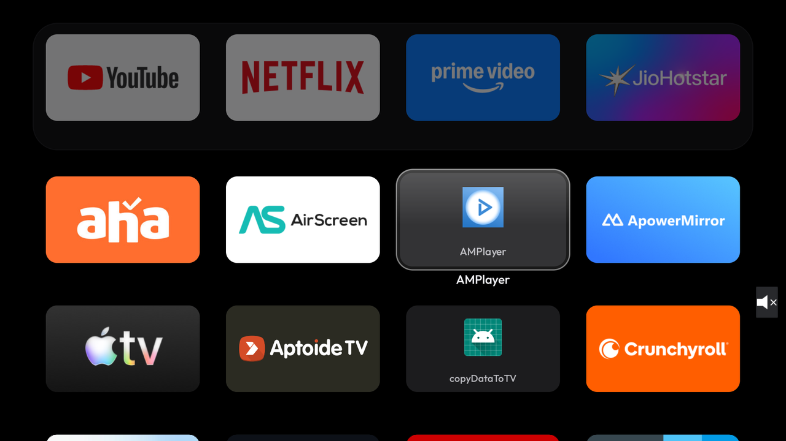
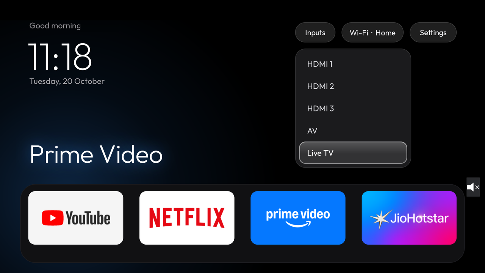
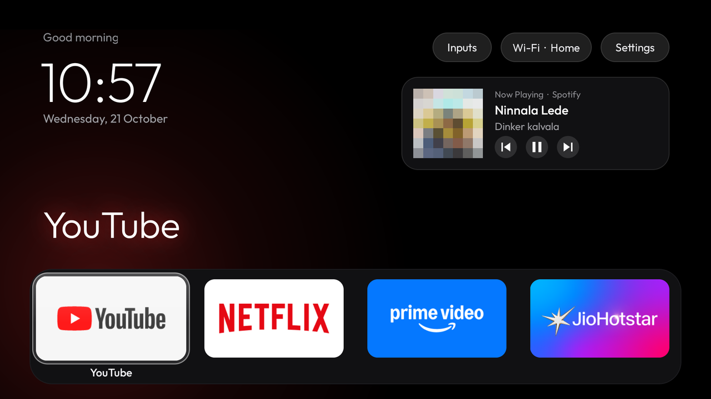
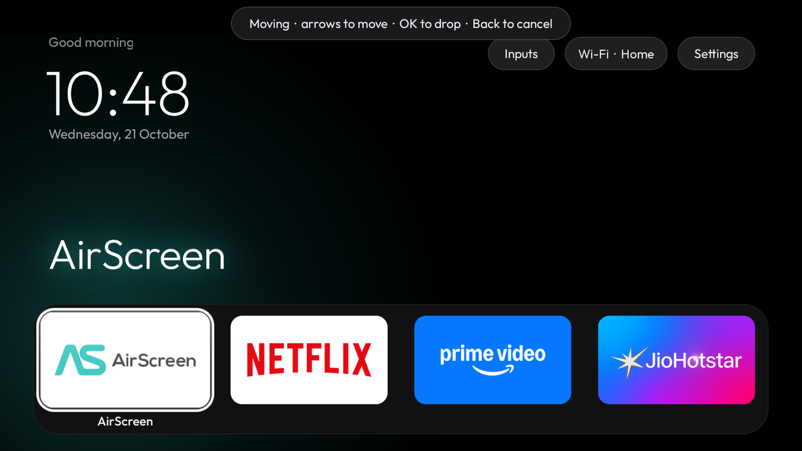

# Glass Home: an Apple TV-style launcher and debloat for Android TV

This repo has a small, fast home screen for Android TV, a debloat of TCL's preloaded telemetry and ads, and the
scripts to set both up over Wi-Fi from a Mac. It was built and tested on a **TCL BeyondTV (Android TV 9, 1080p, 2 GB RAM)**.
Everything is reversible.

> Inspired by **[Gathin23/cleanyourtv](https://github.com/Gathin23/cleanyourtv)**, and built by giving its prompt
> ([docs/PROMPT.md](docs/PROMPT.md)) to Claude Code. If you have a different Android TV, start there: it covers
> 49 brands. This repo is one TV's result, with extras: Now Playing, move mode, and TCL firmware notes.



| App grid | Inputs menu |
|---|---|
|  |  |
| **Now Playing** | **Rearranging apps** |
|  |  |

## Features

- **Apple TV 4K-style home screen**: pitch-black background, a dock of four apps in a lighter rounded band, and the focused
  app's name in large type with a glow in a colour sampled from its banner. A greeting, a large thin clock and the date sit
  top left. The typeface is [Outfit](https://fonts.google.com/specimen/Outfit).
- **One glass highlight** that springs from tile to tile. The focused tile scales up and shows its name.
- **Deterministic D-pad**: Up/Down move exactly one row, the ends of rows never fall through, and the last tile is remembered.
- **All-apps grid** (4 columns) below the dock. Press Down to scroll into it.
- **Top bar pills**:
  - **Inputs** opens a dropdown with HDMI 1–3, AV and Live TV, using the TV input framework.
  - **Wi-Fi** shows the network name.
  - **Settings**.
- **Now Playing card**: when Spotify, YouTube Music or any other media app plays, it shows art, title and artist, with
  previous, play/pause and next. Music keeps playing in the background.
- **Move mode**: hold OK on an app, move it with the arrows (also into and out of the dock), then press OK to drop it. The order is saved on the TV.
- **Light**: about 50 MB of RAM. No blur, no video, no network polling. Updates are event-driven (time tick, package
  changes, connectivity and media sessions).
- **Debloat**: disables TCL analytics, TCL content and ad services, and the partner auto-installer, with `pm disable-user`. Nothing is uninstalled.
- **Optional ad-blocking DNS** using Android's Private DNS (AdGuard).

## What you need

- An **Android TV 9 or newer** set. The launcher should work on most Android TV and Google TV devices. The debloat list
  ([debloat/tcl-beyondtv.txt](debloat/tcl-beyondtv.txt)) is specific to TCL, so review it for other brands.
  This won't work on Samsung Tizen, LG webOS or Fire TV.
- A **Mac** on the same Wi-Fi network, with Python 3 (`python3 --version`). The scripts use macOS's `dns-sd` to find the TV.
  On Linux everything except `tools/find_tv.sh` and `tools/setup_mac.sh` works: set `TV_IP=<address>` and install JDK 17
  and the Android SDK yourself.
- About 2 GB of disk for the build toolchain.

Google's `adb` is **not** needed. `tools/tv` is a small ADB client written in Python (`adb-shell`), which also avoids
macOS Local Network privacy blocking `adb` with "No route to host".

## Replicate this setup, step by step

### 1. Prepare the TV

1. Go to Settings → Device Preferences → About, and press OK on **Build** 7 times. This unlocks Developer options.
2. Go back, open **Developer options**, and turn on **USB debugging**. This TCL set then listens for ADB on port 5555 over Wi-Fi.
3. If anything is plugged into the TV's USB ports, note it. Some boxes cut USB power while debugging is on.

### 2. Get the code and the toolchain

```bash
git clone https://github.com/sridhar02/tcl-tv-glass-house.git
```

```bash
cd tcl-tv-glass-house && tools/setup_mac.sh
```

`setup_mac.sh` installs JDK 17 (Azul Zulu) into `~/Library/Java`, Android SDK 34 into `~/Library/Android/sdk`, and a
Python venv in `.venv`. It needs no sudo and no Homebrew.

### 3. Connect to the TV

```bash
tools/find_tv.sh
```

This finds Android TVs on your network and saves the chosen one to `tools/tv.local`. It saves the TV's stable
`<uuid>.local` name, so a new IP after a reboot doesn't matter. Then connect once:

```bash
tools/tv shell 'getprop ro.product.model'
```

**Look at the TV**: an "Allow USB debugging?" prompt appears. Tick *Always allow from this computer* and press Allow.
The first run creates your private ADB key at `tools/adbkey`. It is git-ignored; never share it.

### 4. Back up before changing anything

```bash
tools/backup.sh
```

This saves package lists, `getprop` output, all settings and the current home app to `backup/` (git-ignored, because it
contains device identifiers).

### 5. Debloat

Read [debloat/tcl-beyondtv.txt](debloat/tcl-beyondtv.txt) first. It explains each package and what is kept on purpose:
Live TV and HDMI, remote and Bluetooth, keyboards, Play Store, Google Assistant, Chromecast, Miracast and all streaming
apps. Delete any line you want to keep, for example the two firmware-update packages. Then:

```bash
tools/debloat.sh
```

It disables the packages in batches of four and saves a screenshot after each batch to `shots/` so you can check the TV
still works. Every disabled package is logged to `backup/disabled_by_us.txt` for the restore script.

### 6. Optional: ad-blocking DNS

```bash
tools/adblock_dns.sh on
```

This sets Private DNS to `dns.adguard-dns.com`. It blocks many ad and tracker domains, but **not YouTube ads**.
`tools/adblock_dns.sh off` undoes it.

### 7. Personalise and install Glass Home

- **Dock apps**: edit `dock_packages` in [launcher/app/src/main/res/values/config.xml](launcher/app/src/main/res/values/config.xml).
  List your packages with `tools/tv shell 'pm list packages'`. You can also rearrange them later on the TV.
- **Greeting name**: add `greeting.name=YourName` to `launcher/local.properties`. That file is git-ignored and
  `setup_mac.sh` creates it.

```bash
tools/build_install.sh
```

The script does the following:
1. Builds the APK and pushes it to the TV, then installs it with `pm install`. (`adb install` can hang waiting for on-screen confirmation.)
2. Grants the location permission. Android 9 needs it to reveal the Wi-Fi name.
3. Grants notification-listener access for the Now Playing card. TV Settings has no screen for this.
4. Sets Glass Home as the home app and disables the stock launcher, which on Android 9 would otherwise always win.

Press Home on the remote.

### 8. Close ADB when you're done

Port 5555 is plaintext, so don't leave it open:

1. On the TV, go to Developer options. Turn **USB debugging** off and use **Revoke USB debugging authorisations**. Then reboot.
2. Check from the Mac:
   ```bash
   nc -vz "$(cat tools/tv.local)" 5555
   ```
   It should say *Connection refused*.
3. On the TCL BeyondTV the toggle sometimes didn't stick. If the port is still open, run:
   ```bash
   tools/tv shell 'settings put global adb_enabled 0'
   ```
   Then revoke the authorisations again.

## Using Glass Home

| Where | Key | Does |
|---|---|---|
| Dock / grid | OK | Open the app |
| Dock / grid | **Hold OK** | Pick the app up (move mode). Arrows move it, OK drops it, Back cancels |
| Dock / grid | Menu | App info (force stop, clear data, disable, uninstall) |
| Dock | Down | Into the app grid |
| Dock | Up | Now Playing card, if something is playing; otherwise the top bar |
| Grid | Back | Back to the dock |
| Top bar | OK | Inputs dropdown / Wi-Fi settings / TV settings |
| Anywhere | Home | Back to the dock |

In move mode, going **Up** from the top grid row moves the app into the dock. A full dock swaps it with the app there.
**Down** from the dock moves it back into the grid. The order is saved on the TV. New apps appear at the end of the grid.

## Customising later

Turn ADB on again (step 1), then edit and run `tools/build_install.sh`.

- **Hide apps from the grid**: add them to `hidden_packages` in `config.xml`.
- **Wallpaper**: put a 1920×1080 picture at `launcher/app/src/main/res/drawable-nodpi/wallpaper.jpg` and set
  `use_wallpaper` to `true`.
- **Reset the order you arranged on the TV**, going back to `config.xml` and an alphabetical grid:
  ```bash
  tools/tv shell 'am force-stop com.sridhar.glasshome; run-as com.sridhar.glasshome rm -f shared_prefs/state.xml'
  ```

## Undo

- **One app**: `tools/tv shell 'pm enable <package>'`
- **Everything**: `tools/restore.sh` re-enables every package logged in `backup/disabled_by_us.txt` (including the stock
  launcher), resets DNS and makes the stock launcher home again. Packages that were already disabled before you started
  are left alone.
- **Remove Glass Home**: `tools/tv shell 'pm uninstall com.sridhar.glasshome'`
- **Without a computer**: go to Settings → Apps → See all apps → Show system apps → *Android TV Home* → Enable.

## Firmware quirks found on the TCL BeyondTV

These are worth knowing if your TV is the same model, or a close relative.

- **The stock launcher always wins on Android 9.** `com.google.android.tvlauncher` has HOME priority 2, so setting another
  default home does nothing until it is disabled. `build_install.sh` handles this.
- **Five TCL apps re-enable themselves at every boot**: `com.tcl.usercenter`, `com.tcl.notereminder`,
  `com.tcl.tv.tclhome_master`, `com.tcl.common.terminalmanagerplus` and `com.tcl.appstatecontroller`. The boot log shows
  the package manager re-scanning them as updated system apps ("Expecting better updated system app …"), which resets
  their state. Disabling `appstatecontroller` doesn't help. Glass Home hides them from its grid instead. The rest of the
  debloat survives reboots.
- **The TV's IP changes after reboots.** `tools/tv.local` stores its mDNS name instead.
- **Live TV and HDMI screenshots come back empty** (0 bytes). That's the TV's protected video path, not a broken debloat.
  Check `tools/tv shell 'dumpsys activity activities | grep mResumedActivity'` instead.
- **The remote's Input button overlay** is drawn by `com.tcl.tv` and doesn't show in screenshots or respond to injected
  keys. Test it with the real remote.
- **TCL's input labels are inconsistent** ("HDMI 1" vs "HDMI2"). Glass Home normalises and sorts them by port number.

## Project layout

| Path | What |
|---|---|
| `launcher/` | Glass Home source: Java, AndroidX RecyclerView, minSdk 28, targetSdk 34 |
| `launcher/app/src/main/res/values/config.xml` | Dock apps, hidden apps, wallpaper switch |
| `debloat/tcl-beyondtv.txt` | Debloat list with a reason for each package |
| `tools/tv` | ADB client: `shell '<cmd>'`, `push`, `pull`, `screencap <file.png>`, `key <KEYCODE>…` |
| `tools/setup_mac.sh` | JDK 17 + Android SDK + Python venv |
| `tools/find_tv.sh` | Find the TV on the network and save it to `tools/tv.local` |
| `tools/backup.sh` | Snapshot packages and settings to `backup/` |
| `tools/debloat.sh` / `tools/disable.sh` | Disable the list in batches / disable given packages, logged |
| `tools/adblock_dns.sh` | Private DNS on/off |
| `tools/build_install.sh` | Build, install, grant permissions, set as home |
| `tools/restore.sh` | Undo all of it |

Not in the repo, all git-ignored: `tools/adbkey` (your ADB private key), `tools/tv.local` (your TV's address),
`backup/` (device identifiers), `shots/` (screenshots of your TV), `launcher/local.properties` (paths, greeting name).

## How it works (for the curious)

- **Focus is not Android view focus.** The activity keeps its own cursor (zone + index) and handles every D-pad key
  itself. That makes navigation fully predictable: dock, grid, top bar, Now Playing and the inputs menu.
- **The glass highlight** is a single view drawn above everything. Each frame it re-reads its target's rectangle and
  integrates a slightly underdamped spring, so it follows tiles even while the page or grid scrolls.
- **Grid scrolling** reads the real scroll position from the laid-out rows each time. An earlier version kept a running
  total, which drifted after the app list reloaded.
- **Now Playing** uses `MediaSessionManager` with a do-nothing `NotificationListenerService` for access, and reacts to
  session callbacks.

## Inspiration and credits

- **[cleanyourtv](https://github.com/Gathin23/cleanyourtv)** by [Gathin](https://github.com/Gathin23) (MIT) is where
  this started. Its prompt asks a coding assistant to:
  - debloat an Android TV over Wi-Fi, safely and reversibly, with a backup first;
  - replace the home screen with an Apple TV-style launcher;
  - verify every step with screenshots from the TV.

  The prompt is included unchanged, with its licence notice, in [docs/PROMPT.md](docs/PROMPT.md). The design brief
  (black background, dock band, glass highlight, Outfit, Inputs dropdown, deterministic D-pad) comes from it.
- **Built with [Claude Code](https://claude.com/claude-code)** from that prompt, with the TV model "Beyond TV Version 9",
  working on the real TV over ADB. The launcher here was written from scratch for this TV rather than taken from
  cleanyourtv's `launcher/`. Now Playing, move mode, the scroll fix and the TCL firmware findings came later in the
  same sessions.
- **[Outfit](https://github.com/Outfitio/Outfit-Fonts)** typeface by The Outfit Project Authors (SIL OFL 1.1).
- **[AdGuard DNS](https://adguard-dns.io/)** for the optional ad-blocking resolver.
- **[adb-shell](https://github.com/JeffLIrion/adb_shell)** for the Python ADB client.

## Licence

Code: [MIT](LICENSE). The Outfit font is under the SIL Open Font License; see
`launcher/app/src/main/assets/fonts/OFL.txt`. App names and logos in the screenshots belong to their owners.
